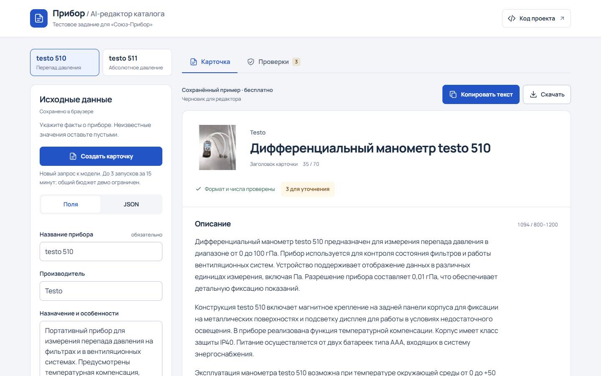

# Прибор / AI-помощник контент-менеджера

Прототип для подготовки карточек контрольно-измерительных приборов в B2B-каталоге. На входе — поля формы или JSON с фактами о товаре. На выходе — SEO-заголовок, описание, характеристики, поисковые запросы, блок для менеджера и список уточнений.

**[Открыть работающую демонстрацию](https://ai-kabinet.ru/pribor-studio/)** — без установки и регистрации. Приложение размещено отдельно на сервере владельца. Готовые примеры доступны бесплатно; новая генерация ограничена общим демонстрационным бюджетом и частотой запросов.

Нажмите **«Ввести свой прибор»**, заполните данные и нажмите **«Создать карточку с ИИ»**. Gemini 4 Argon через OpenRouter подготовит черновик. Если проверка отклонит текст, эта же модель может один раз исправить его по исходным данным и конкретным замечаниям. В сведениях о результате видны модель, число попыток, общее время и подтверждённая стоимость. Готовые примеры основаны на ответах Gemini 3 Flash Preview и вычитаны редактором. Их можно просматривать и скачивать бесплатно.

[Сверка с требованиями задания](docs/ASSIGNMENT.md) · [Готовое сопроводительное сообщение](SUBMISSION.md)



[Посмотреть мобильный интерфейс](docs/screenshots/mobile.png).

## Запуск за минуту

Требуется **Python 3.11 или новее**. У приложения нет внешних зависимостей и этапа сборки.

```sh
git clone https://github.com/evdokimow8-star/souz-pribor-ai-test.git
cd souz-pribor-ai-test
python -m pribor
```

Откройте **http://127.0.0.1:8765**. На Windows можно запустить `start.cmd`. На macOS/Linux вместо `python` при необходимости используйте `python3`.

1. Сразу откроется готовая карточка `testo 510`. Переключателем рядом можно открыть `testo 511`.
2. Нажмите **«Ввести свой прибор»**, чтобы открыть отдельную форму. Заполните обычные поля или вставьте JSON. На компьютере данные расположены слева от карточки.
3. В **«Проверках»** посмотрите недостающие сведения и связи текста с исходными фактами.
4. **«Копировать текст»** копирует обычный текст. **«Скачать»** предлагает JSON и Markdown. На телефоне эти действия закреплены внизу экрана.

Правки своего прибора и двух примеров сохраняются отдельно в этом браузере. При изменении входа предыдущая карточка остаётся доступной с явной отметкой, что она относится к прежним данным. Ошибка новой генерации сохраняет успешный результат. После исчерпания одной попытки исправления следующий запуск требует отдельного нажатия.

Текст результата можно отредактировать без нового вызова модели. После этого карточка и экспорт отмечены как ручная редакция, требующая повторной проверки. Исходные характеристики и доказательства ответа модели сохраняются; доступно восстановление исходного текста.

## Новая генерация через API

Скопируйте `.env.example` в `.env` и заполните:

```dotenv
LLM_API_KEY=ваш_ключ
LLM_BASE_URL=https://openrouter.ai/api/v1
LLM_MODEL=google/gemini-4-argon
LLM_TIMEOUT_SECONDS=60
```

Перезапустите локальный сервис. Кнопка **«Создать карточку с ИИ»** станет активной. В локальном и публичном режиме Argon выполняет один запрос, а при отклонении текста проверкой может сделать одну попытку исправления. Каждый вызов оплачивается по тарифу API. Исправление разрешено после полученного ответа с подтверждённой стоимостью. При тайм-ауте, ошибке API или неизвестной стоимости автоматический повтор блокируется.

Также поддерживается совместимый `chat/completions` API с `json_schema`. Выбранный endpoint должен поддерживать structured outputs. Для другого провайдера задайте его базовый URL и модель. Локальный HTTP допустим только для loopback-адресов; внешние API требуют HTTPS.

API-ключ читается только сервером из окружения / `.env`, не передаётся браузеру и не хранится в исходном коде. `.env` исключён из Git.

## Входные данные

```json
{
  "name": "Прибор модели X",
  "manufacturer": "Завод",
  "specs": {
    "Диапазон измерений": "0 ... 100 гПа",
    "Питание": null
  },
  "description": "Подтверждённое назначение и особенности из паспорта.",
  "source_url": "https://example.org/product",
  "notes": ["Уточните комплект поставки у поставщика."]
}
```

`name` обязателен и ограничен 70 символами, чтобы полное название помещалось в заголовок. `manufacturer`, `description`, `specs`, `source_url`, `notes` могут отсутствовать. Значения характеристик — строки или `null`. Неизвестные поля, повторяющиеся ключи JSON и недопустимые типы отклоняются. Для генерации нужны хотя бы назначение или непустые характеристики.

Пропущенные базовые поля и характеристики с `null` попадают в `missing_fields`. Программа не знает обязательные параметры всех классов приборов: неизвестную пользователю характеристику следует явно добавить со значением `null`.

`source_url` — ссылка для редактора. Приложение не скачивает её автоматически и не дополняет входные данные знаниями из интернета.

## Что получает редактор

- `seo_title`: до 70 символов с пробелами, с точным названием товара.
- `seo_description`: 800–1200 символов с пробелами и переводами строк.
- `characteristics`: значения переносятся из входа программно, пустые помечаются «данных нет».
- `search_queries`: 3–5 разных поисковых фраз; частотность не заявляется.
- `commercial`: аудитория, задача и уточнения перед подбором.
- `missing_fields`, `warnings`: недостаток данных и замечания редактору.
- `evidence`: связи текстовых блоков с исходными фактами.
- `validation`: длины и результат формальных проверок.
- `generation`: модель и стоимость, **сообщённая API**. `null` означает отсутствие цены в ответе, а не бесплатный запрос.

## Примеры двух товаров

Выбраны две разные задачи измерения давления из предоставленного каталога:

- [testo 510: вход](examples/inputs/testo-510.json), [ответ модели с происхождением](examples/results/testo-510.json), [готовый Markdown](examples/results/testo-510.md).
- [testo 511: вход](examples/inputs/testo-511.json), [ответ модели с происхождением](examples/results/testo-511.json), [готовый Markdown](examples/results/testo-511.md).

[Источники и решение по противоречивой гарантии](examples/SOURCES.md).

Хэш входа привязывает сохранённый ответ к конкретным данным. При несовпадении пример блокируется. Во время просмотра сохранённые ответы заново проходят текущий валидатор.

## Проверки

```sh
python -m unittest discover -v
```

Все обязательные тесты используют стандартную библиотеку. Нет платных вызовов, внешних сервисов, базы данных или GitHub Actions. HTTP-тесты поднимают временный сервер только на `127.0.0.1`.

Проверяются ошибки JSON/типов, отсутствующие данные, ложные технические обозначения и единицы, новые числа, неполные ссылки на факты, объём текста, ошибки API и тайм-аут, защита ключа и локального HTTP-интерфейса. Числовая проверка учитывает десятичную запятую; предлог «В» не считается вольтом.

Опциональный сценарий `tests/browser_smoke.py` проверяет Edge на ширинах 320, 360, 390, 430, 768, 1024 и 1440 px: полезный первый экран без автоматической прокрутки, оба товара, форму и JSON, сохранение черновиков, успех и ошибку генерации, ручную редакцию, копирование, выгрузки, фокус и axe. Вызовы генерации заменяются тестовым ответом до отправки серверу. Для запуска нужны установленный Playwright, Edge и уже работающий локальный сервис:

```sh
python tests/browser_smoke.py --url http://127.0.0.1:8765/ --output /tmp/pribor-ui-check
```

Это браузерные проверки размеров экрана; они не заменяют проверку аппаратной клавиатуры и Safari на настоящем телефоне.

## Архитектура и решения

```text
JSON → нормализация → реестр фактов → Argon → проверка
     → при ошибке текста: одно исправление той же Argon → повторная проверка
     → точные характеристики из входа → JSON / Markdown / веб-карточка
```

`pribor/domain.py` — входной контракт, схема ответа и проверки. `pribor/llm.py` — промпт, конфигурация и транспорт API. `pribor/server.py` — локальный HTTP и примеры. `web/` — интерфейс без сборщика и CDN.

[Подробности промпта, проверок и ограничений](docs/DECISIONS.md). [Сопроводительное сообщение](SUBMISSION.md).

## Ограничения

Это **черновик для редактора**, а не автоматическая публикация. Совпадение чисел, единиц и ссылок на факты не доказывает смысловую корректность всех предложений. Оценочные или качественные выдумки могут не попасть под формальные проверки. Исходные данные тоже могут содержать ошибку.

Прототип не включает CMS, авторизацию и массовую генерацию. Локальный режим слушает только loopback и допускает одну генерацию одновременно. Публичная демонстрация работает через отдельный reverse proxy и использует SQLite для бюджета и лимитов. Черновики и результаты сохраняются в IndexedDB текущего профиля браузера. Ранее сохранённые черновики импортируются при первом открытии. Если две вкладки меняют один черновик, устаревшая правка остаётся видимой в своей вкладке с предупреждением о конфликте. Смена модели или промпта требует повторной оценки качества.

[Размещение и ограничения публичной демонстрации](docs/HOSTING.md).
